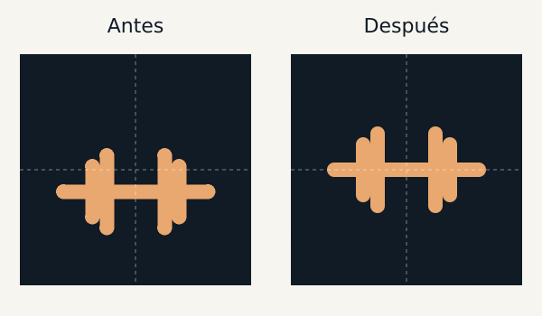

# Icon centering

These are rendered asset comparisons, not screenshots taken on an iPhone.
`before.png` is the original 512px PNG from main; `after.png` is the corrected export.

## Root cause

The SVG viewBox is `0 0 64 64`. Including its 4-unit rounded stroke, the
dumbbell bounds were x=[10,54], y=[26,50], centered at (32,38) rather than
(32,32). The six-unit vertical displacement was also present in the existing
PNG assets. The small horizontal PNG offset was rasterization rounding, not
an asymmetric SVG glyph. Only the glyph is translated by (0,-6).

The manifest does not declare `purpose: maskable`, so maskable padding was not
the cause. The corrected glyph also fits the central circular safe area with
radius 40% of the canvas size, without shrinking or changing the design.

The original PNGs have an opaque square background, whereas the SVG has rounded
background corners. Regeneration flattens onto the original #111b25 background
to preserve PNG appearance. The glyph remains #e9a86f and retains its stroke.

## Measurements

Coordinates use pixel centers (pixel index + 0.5). Bounds are measured from
the warm-color glyph pixels, excluding the dark background and faint edge pixels.

| Asset | Canvas | Before bounds-center offset (x,y) | After bounds center | After centroid | After offset |
| --- | --- | --- | --- | --- | --- |
| apple-touch-icon.png | 180x180 | (0,17) px | (90,90) | (90,90) | (0,0) px |
| icon-192.png | 192x192 | (0.5,18.5) px | (96,96) | (96,96) | (0,0) px |
| icon-512.png | 512x512 | (0.5,48.5) px | (256,256) | (256,256) | (0,0) px |

`tests/icons.test.cjs` independently decodes the PNGs using Node built-ins,
checks both centers within 1px, dimensions, colors, safe-area fit, and URL/cache
version alignment. All Node tests are dependency-free.

## Regeneration

`node scripts/generate-icons.cjs` exports all three PNGs directly from the SVG
and refreshes the comparison. This development-only script requires `sharp`
available to Node; it adds no browser/runtime dependency or build requirement.

## iPhone update

iOS caches the Home Screen icon. After this PR is merged and GitHub Pages has
deployed, export a JSON backup from the app first. Then remove the app from the
Home Screen and add it again from Safari using the same production address.
Restore the backup if any local data is missing. URL versioning alone may not
refresh an already installed Home Screen icon. No on-device check was performed.

Production URL, manifest start URL/scope, service-worker scope, and IndexedDB
are unchanged. Cache v31 and versioned icon/manifest URLs ship together.
